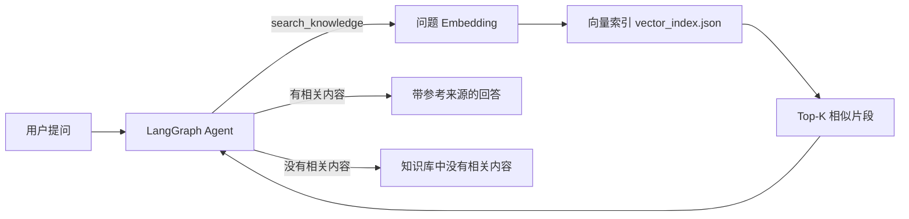

# 客服知识库 Agent（RAG 问答系统）

基于 **Embedding + 向量检索 + Function Calling + LangGraph** 的客服知识库问答 Agent。用户问政策类问题时，系统先从本地知识库中检索相关片段，再由 LLM 结合检索结果生成带参考来源的回答；知识库中没有答案时，系统明确回复“知识库中没有相关内容”，不编造。

## 1. 项目目标

把 5 份客服政策文档变成可以自然语言问答的知识库助手：

- 退款政策
- 会员政策
- 支付与发票政策
- 商品保修政策
- 物流与运费政策

本项目用于练习并展示一条完整的 RAG 链路：

```text
文档切分
  -> 文本 Embedding
  -> 向量索引
  -> 相似度检索
  -> Agent 工具调用
  -> 带来源回答 / 无答案拒绝
```

## 2. 技术栈

- Python 3.11+
- DeepSeek Chat API（对话模型，OpenAI 兼容接口）
- SiliconFlow Embedding API（qwen3.7-text-embedding，维度 1024）
- LangGraph（Agent 状态流转与工具调用）
- 本地文件作为轻量向量索引
- 余弦相似度做语义检索

## 3. 系统架构



核心循环：

1. 用户问题进入 LangGraph 的 Agent 节点。
2. LLM 判断需要调用 `search_knowledge` 工具。
3. 工具把用户问题转成向量，与知识库向量做余弦相似度计算。
4. 返回最相关的 Markdown 片段及其来源。
5. LLM 根据片段生成回答，并标注参考来源。
6. 检索结果不足以回答时，LLM 明确拒绝，不编造。

## 4. 目录结构

```text
project-2-knowledge-agent/
├── docs/                     # 原始知识库文档（Markdown）
│   ├── membership-policy.md
│   ├── payment-policy.md
│   ├── product-warranty.md
│   ├── refund-policy.md
│   └── shipping-policy.md
├── test/
│   └── evaluate_rag.py       # RAG 评测脚本
├── chunk_docs.py             # Markdown 分块，生成 chunks.jsonl
├── build_vector_index.py     # 生成向量索引 vector_index.json
├── semantic_search.py        # 语义检索
├── knowledge_agent.py        # LangGraph Agent 入口
├── eval_questions.jsonl      # 30 条评测问题
├── chunks.jsonl              # 分块结果
├── vector_index.json         # 向量索引
├── .env                      # API Key 等配置（不提交到 Git）
└── README.md
```

## 5. 快速开始

### 5.1 准备环境

```bash
cd ~/agent-lab/project-2-knowledge-agent

# 如果项目有独立虚拟环境
python3 -m venv .venv
source .venv/bin/activate

# 如果与 project-1 共用虚拟环境
# source ~/agent-lab/project-1-customer-agent/.venv/bin/activate
```

安装依赖：

```bash
pip install requests python-dotenv langgraph
```

> 如果代码还使用了其他包，以 `python3 knowledge_agent.py` 首次运行时的 import 为准补齐。

### 5.2 配置 API Key

在 `.env` 中配置：

```text
# DeepSeek 对话模型
DEEPSEEK_API_KEY=sk-xxxx
DEEPSEEK_BASE_URL=https://api.deepseek.com/v1
CHAT_MODEL=deepseek-chat

# SiliconFlow Embedding 模型
EMBEDDING_API_KEY=sk-xxxx
EMBEDDING_BASE_URL=https://api.siliconflow.cn/v1
EMBEDDING_MODEL=qwen3.7-text-embedding
```

> 具体变量名以代码中的实际读取名称为准。不要把 `.env` 提交到 GitHub。

### 5.3 重建索引

修改 `docs/` 后需要重新执行：

```bash
python3 chunk_docs.py
python3 build_vector_index.py
```

执行成功后会看到：

```text
使用模型：qwen3.7-text-embedding
处理第 1/19 条：membership-policy.md / 会员等级
...
完成，共 19 条向量
向量维度：1024
```

### 5.4 启动 Agent

```bash
python3 knowledge_agent.py
```

输入 `/quit` 退出。

示例问题：

```text
钱什么时候退回来？
七天无理由退货需要满足什么条件？
发到偏远地区要多久？
你们公司的老板是谁？
```

## 6. 项目验证

### 6.1 评测数据

- 知识库文档：5 份
- 分块数量：19
- 向量维度：1024
- 评测题数：30
  - 有标准答案：25 题
  - 无答案（测试拒绝乱编）：5 题

### 6.2 评测指标

| 指标           | 结果         |
| -------------- | ------------ |
| hit@1          | 25/25 = 100% |
| hit@3          | 25/25 = 100% |
| 无答案正确拒绝 | 5/5          |

评测脚本：

```bash
python3 test/evaluate_rag.py
```

如果 `evaluate_rag.py` 放在项目根目录，则执行：

```bash
python3 evaluate_rag.py
```

### 6.3 失败案例分析

首轮评测出现 1 次“未命中第一名”：

```text
问题：退款会原路退回原来的支付账户吗？
实际第 1 名：refund-policy.md / 退款时效
```

排查结论：这是标准答案漏标，不是检索错误。`refund-policy.md` 的“退款时效”本身包含“原路退回”，同时 `payment-policy.md` 也包含该规则。把该题的标准答案修正为：

```json
{
  "question": "退款会原路退回原来的支付账户吗？",
  "expected_sources": ["refund-policy.md", "payment-policy.md"]
}
```

修正后命中率为 100%。

### 6.4 无答案行为验证

对知识库没有收录的问题，Agent 的回复统一为：

```text
知识库中没有相关内容。
```

已验证的问题包括：

- 你们的公司地址在哪里？
- 你们公司的老板是谁？
- 你们的股票代码是什么？
- 帮我推荐一款适合办公的笔记本电脑？
- 你们有线下实体门店吗？

## 7. 关键设计说明

### 分块策略

按 Markdown 标题切块：

- 每个 `##` 标题作为一个独立知识片段
- 标题下正文与该标题合并
- 保留 `source` 和 `heading`，用于回答时引用来源

### 检索策略

当前使用向量检索：

```text
query embedding
  -> 与 19 条 chunk embedding 计算余弦相似度
  -> 返回 Top-K
```

### 防幻觉

`system prompt` 要求 LLM：

1. 只能依据 `search_knowledge` 返回的片段回答。
2. 片段不足时必须说“知识库中没有相关内容”。
3. 回答中标记来源文件与标题。

## 8. 局限与后续改进

当前版本适合学习和小数据量验证，距离生产环境还有以下差距：

- 向量直接存 JSON 文件，规模大后应换 Chroma / Qdrant / Milvus。
- 只有向量检索，可增加关键词检索形成 Hybrid Search，再重排。
- 可对比 chunk 大小、overlap、top_k、相似度阈值对命中率的影响。
- Agent 当前为本地交互，后续可用 FastAPI 包装成 HTTP 服务。
- 可增加会话记忆、日志追踪、token 成本统计。

## 9. 学习收获

本项目验证了 RAG 问答的完整闭环：

- 知道如何把 Markdown 切分成可检索的片段
- 知道 Embedding API 如何把文本转成向量
- 知道向量检索和余弦相似度排名的意义
- 知道如何用 LangGraph 把检索封装成 Agent 工具
- 知道如何用评测集量化检索命中率
- 知道无答案问题时 Agent 应该如何拒绝
